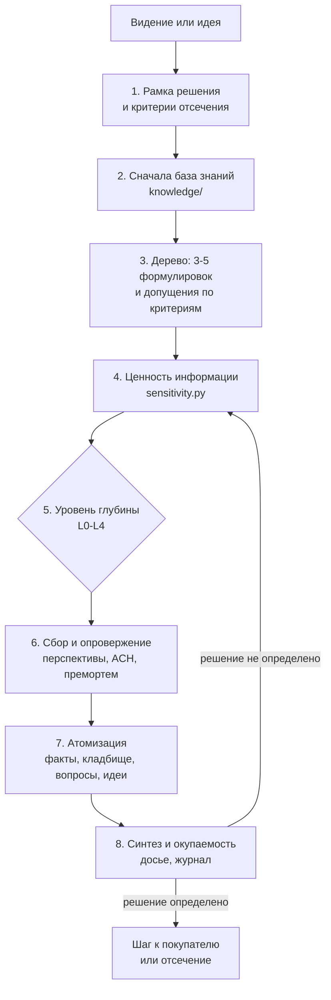

# Методология: исследование как инвестиция

Методология исследования идей, гипотез и рыночных направлений для тех, кто выбирает, во что вложить время, — основателей, продактов, венчурных аналитиков. Она рассчитана на работу с LLM-агентом (Claude Code или любой чат с веб-поиском), но работает и вручную.

## Суть

Исследование — это ставка: в неё вкладываются время и токены, а отдача бывает трёх видов. Первая — **решение** по текущей идее: отсечь, отложить, копать глубже или идти к покупателю. Вторая — **знание, которое переиспользуется** в следующих идеях: факты о рынках, каналах, покупателях, сделках. Третья — **новые гипотезы**: соседние идеи, развороты, открытые вопросы. Исследование, которое дало только одну из трёх, окупилось наполовину; брошенное на середине не окупилось вовсе.

Методология отвечает на четыре вопроса, и на каждый есть проверенный фреймворк:

| Вопрос | Ответ методологии | На чём основано |
| --- | --- | --- |
| Что исследовать? | Не идею целиком, а её самые рискованные допущения, привязанные к критериям рубрики | Карта допущений (Bland), дерево возможностей (Torres), дерево вопросов (MECE) |
| В каком порядке? | По ценности информации: сначала то, что может сменить решение, и то, что ещё никто не мерил | Applied Information Economics (Hubbard) |
| Насколько глубоко? | До уровня, на котором решение определено, но не меньше критерия завершения начатого уровня | Ценность информации, критерии остановки (Duke), уровни доказательств (Gilad) |
| Как не потратить зря? | Каждый факт — атом в базе знаний, каждая отброшенная гипотеза — на кладбище с условием воскрешения, каждое исследование — строка в журнале окупаемости | Атомарные исследования (Sharon, Pidcock), evergreen-заметки (Matuschak) |

Опровержение (ACH, премортем, базовая частота) встроено в каждый уровень глубже скрининга. Финал любого исследования — следующий шаг к разговору с покупателем: инвестор и рынок платят за доказательства, а не за кабинетную работу.

## Принципы

1. **Решение раньше поиска.** Исследование начинается с вопроса «какое решение оно изменит», а не с темы.
2. **Доказательства выше мнений.** Любое утверждение о текущем мире — с источником и датой. Оценка модели без поиска — гипотеза, и рубрика ограничивает её потолком.
3. **Ищи опровержение.** Неудобный факт записывается рядом с удобным.
4. **Дешёвые фильтры раньше дорогих.** Каждый следующий уровень дороже предыдущего и применяется только к тому, что не отсеялось раньше.
5. **Слабое звено не компенсируется.** Оценки объединяются мультипликативно: большой рынок не спасает идею без платящего.
6. **Ничего не теряется.** Каждый факт, тупик и вопрос остаются в базе знаний для следующих исследований.
7. **Честность о границах.** Каждый вывод — с датой данных, тем, чего не проверяли, и тем, где источники расходятся.

## Фреймворки, из которых собрана методология

| Фреймворк | Суть | Что берём | Чего не берём и почему |
| --- | --- | --- | --- |
| Applied Information Economics, Д. Хаббард | Ценность измерения переменной считается через то, насколько оно может изменить решение; сначала мерить самое ценное. «Инверсия измерений»: больше всего стоит измерять то, что обычно не мерят. Наибольшая отдача — от первого небольшого снижения неопределённости | Приоритет по ценности информации; анализ чувствительности Score; правило «первые поиски самые дешёвые и ценные» | Монте-Карло и денежный расчёт EVPI: для оценок 1–5 достаточно проверки «может ли критерий перевести Score через порог» |
| Assumptions Mapping, Д. Бланд (Testing Business Ideas) | Допущения делятся на желанность, реализуемость и жизнеспособность и раскладываются по осям «важность × доказанность». Эксперименты — в углу «важно и не доказано» | Тип допущения, матрица важности и доказанности, выбор самого дешёвого эксперимента под риск | Каталог из 40+ экспериментов: в репозитории достаточно уровней L0–L4 |
| Opportunity Solution Tree, Т. Торрес | Дерево: желаемый результат → возможности → решения → проверки допущений. Сравнивать несколько вариантов, а не решать «да или нет» по одному | Разбор видения в дерево; правило «сначала 3–5 формулировок, потом углубление в лучшую» | Еженедельный ритм продуктовой тройки — это про работающий продукт |
| Дерево вопросов, MECE и принцип пирамиды, Б. Минто | Центральный вопрос дробится на непересекающиеся ветви без пропусков; вывод излагается первым | Разбор видения на вопросы без пропусков; досье начинается с решения | — |
| STORM, Стэнфорд | Модель задаёт более глубокие вопросы, если смотрит на тему с разных перспектив и уточняет в диалоге с источниками | Сбор вопросов от 7 перспектив (покупатель, пользователь, конкурент, инвестор, регулятор, канал, скептик), параллельные субагенты на уровне L2 | Генерация статьи в стиле Википедии |
| Analysis of Competing Hypotheses, Р. Хойер (ЦРУ) | Матрица «гипотезы × свидетельства»; цель — опровергнуть, а не подтвердить. Свидетельство, совместимое со всеми гипотезами, ничего не сообщает | Матрица конкурирующих объяснений «почему идея не сработает» и проверка диагностичности фактов | Полные 8 шагов: достаточно матрицы и вывода |
| Премортем, Г. Кляйн | Представить, что проект уже провалился, и перечислить причины | Обязательный премортем на L2: 5 причин провала с вероятностью и способом проверки | — |
| Прогноз по референтному классу, Канеман и Фливбьерг | Смотреть на распределение исходов похожих проектов, а не только на свой план | Базовая частота: как обычно заканчиваются похожие стартапы и в какие сроки | Количественная поправка на оптимизм: нет выборки |
| Confidence Meter, И. Гилад | Уверенность в идее зависит от типа доказательства: мнение < оценка < данные < результат теста | Шкала уровней доказательства E0–E6 у каждого атома и допущения | Числовой балл 0–10: заменён уровнями, связанными с потолками рубрики |
| The Mom Test, Р. Фицпатрик | В разговоре с клиентом спрашивать о прошлом поведении, а не мнении; встреча успешна, только если дала обязательство (время, репутация, деньги) | Уровни E4–E6; правила интервью на L3 | — |
| Критерии остановки, Э. Дьюк (Quit) | Заранее записать состояние и дату, при которых бросаешь: решение принимается до того, как появится желание продолжать | До первого поиска записываются критерии отсечения и бюджет уровня | — |
| Атомарные исследования, Т. Шарон и Д. Пидкок | Находка дробится на «самородки»: наблюдение, доказательство, теги. Самородки живут в общем репозитории и ищутся по тегам | База `knowledge/facts.jsonl`: один факт — одна строка с источником, датой и тегами | Видео и скриншоты: у нас текст и ссылки |
| Evergreen-заметки, Э. Матушак | Заметки атомарны, организованы по понятиям, а не по источникам или проектам, и густо связаны | Атомы тегируются по рынку, покупателю, каналу и критерию, а не по идее; кросс-идейные выводы — в `knowledge/patterns.md` | — |

Источники по каждому фреймворку — в конце файла. Атрибуция атомарных исследований расходится: одни источники называют автором Шарона (WeWork, 2017), другие Пидкока (2018); здесь указаны оба.

## Восемь шагов

### Шаг 1. Рамка решения

До первого поиска записываются четыре вещи:

1. **Решение**, которое обслуживает исследование: отсечь, отложить, копать глубже, идти к покупателю.
2. **Уровень** L0–L4 и его **бюджет** (поиски и время).
3. **Критерии отсечения**: какой найденный факт останавливает работу. Например: «крупный игрок уже делает это основным продуктом», «чек мал и нет партнёрского канала».
4. **Критерий завершения** уровня из таблицы шага 5.

Без рамки исследование расползается: каждый найденный факт тянет за собой следующий, и бюджет кончается раньше решения.

### Шаг 2. Сначала база знаний

До веб-поиска — поиск по `knowledge/`: `python knowledge/kb.py find <тег или слово>`. Атом со свежей датой проверки не ищется заново; устаревший (рыночные данные старше 6 месяцев, сделки старше 3) перепроверяется и обновляется. Сюда же — `knowledge/graveyard.md` (не отбросили ли это раньше) и `knowledge/questions.md` (не висит ли вопрос, на который это исследование ответит заодно).

### Шаг 3. Дерево формулировок и допущений

**Из видения — несколько идей.** Видение («заменить соцсети полезным микроконтентом») — ещё не идея: в нём нет покупателя и механики. Оно разбирается по осям — проблема, покупатель, монетизация, технологическое ядро, канал — в 3–5 формулировок, которые отличаются покупателем или монетизацией, а не словами. Все проходят дешёвый скрининг L0, вглубь идёт лучшая. Так один час даёт сравнение вариантов вместо ответа «да или нет» по одному.

**Из идеи — допущения.** Каждое допущение привязывается к критерию рубрики, тогда исследование прямо двигает Score. Для рубрики по умолчанию ([scoring/rubric.json](scoring/rubric.json)):

| Тип допущения | Вопрос | Критерий |
| --- | --- | --- |
| Желанность | Есть ли боль и хотят ли решение? | P |
| Кто платит | Кто платит, из какого бюджета, кто подписывает? | B |
| Рынок | Сколько покупателей и какой чек? | M |
| Окно | Что открылось за последние 1–2 года? | W |
| Канал | Как придут первые 10 покупателей? | G |
| Экономика | Окупает ли чек привлечение? | U |
| Защита | Почему не скопируют за месяц? | D |
| Скорость | Сколько до первых денег? | S |
| Команда | Почему именно эта команда? | F |
| Монополист | Не делает ли это крупный игрок основным продуктом? | K4 |

### Шаг 4. Ценность информации

У каждого критерия есть текущая оценка и **правдоподобный диапазон** — от худшего до лучшего значения, которое не противоречит уже известному. Скрипт `scoring/sensitivity.py` считает Score в худшем и лучшем случае и размах по каждому критерию:

- Если даже лучший случай ниже порога — идея отсекается, дальнейшее исследование не окупится. Записать на кладбище с условием воскрешения.
- Если даже худший случай выше порога — исследование рынка не нужно, следующий шаг — покупатель.
- Иначе исследуются только критерии, чей диапазон переводит Score через порог, в порядке размаха. Это и есть ценность информации в терминах рубрики.

Поправка на инверсию измерений Хаббарда: при равном размахе приоритет у того, что обычно не мерят. Почти всегда это «кто платит» и канал, а не размер рынка, на который по привычке уходит больше всего поисков.

### Шаг 5. Уровни глубины

| Уровень | Вопрос | Что делать | Бюджет | Критерий завершения |
| --- | --- | --- | --- | --- |
| L0 Скрининг | Стоит ли тратить час? | Стоп-критерии, оценки по якорям, 1–2 поиска на окно и монополиста | до 5 поисков, ~15 мин | Стоп-критерии, черновой Score, топ-3 допущения, диапазоны для `sensitivity.py` |
| L1 Кабинетная проверка | Держатся ли критерии с потолками на источниках? | Источник для каждого критерия с `ceiling_without_source`, проверка монополиста, поиск опровержения | 15–30 поисков, 1–2 ч | У каждого критерия с потолком источник или потолок; монополист проверен; найдено хотя бы одно опровержение |
| L2 Досье | Что мир знает о самых рискованных допущениях и кто первые покупатели? | Перспективы, субагенты, ACH, премортем, базовая частота | 40–80 поисков, полдня | Карта допущений с уровнями доказательств, матрица ACH, премортем, базовая частота, список 10–15 первых покупателей (роль и тип компании), сценарий интервью |
| L3 Покупатели | Подтверждают ли покупатели боль прошлым поведением и обязательством? | Интервью по Mom Test | 5–15 разговоров, 1–2 недели | P и B на уровне E4 и выше, хотя бы одно обязательство E5 |
| L4 Деньги | Платят ли? | Пилот, предоплата | 1–3 месяца | E6: деньги или оплаченный пилот |

**Правило перехода.** На следующий уровень идея идёт, только если решение на текущем не определено (шаг 4) и самое ценное нерешённое допущение нельзя закрыть на текущем уровне. L2 не обязателен: если после L1 идея проходит и есть с кем говорить, следующий шаг — сразу L3. Кабинетная работа после L1 без разговора с покупателем — подготовка, и её нужно так и называть.

**Правило глубины.** Начатый уровень доводится до критерия завершения либо останавливается по критерию отсечения или по шагу 4, и причина остановки записывается. Третьего исхода — «бросили на середине» — нет: именно он сжигает время без отдачи. Превышение бюджета уровня на 50% — повод остановиться и записать, почему вопрос оказался дороже, а не молча продолжать.

### Шаг 6. Сбор и опровержение

**Вопросы по перспективам** (по STORM). На L1–L2 вопросы порождаются не от идеи, а от семи ролей. Каждая роль даёт 3–5 вопросов, каждый вопрос привязан к допущению из шага 3:

| Перспектива | Типичный вопрос | Где искать |
| --- | --- | --- |
| Покупатель | Из какого бюджета платят сейчас, сколько, кто подписывает? | Вакансии, тендеры и закупки, отраслевые отчёты |
| Пользователь | Как решают задачу сейчас и сколько времени теряют? | Отзывы, форумы, отраслевые сообщества |
| Конкурент и монополист | Кто уже делает, на каких условиях, почему не захватил рынок? | Сайты, прайсы, магазины приложений, открытая отчётность |
| Инвестор | Кто финансировал похожее, кто покупал такие компании? | Crunchbase, Dealroom, отраслевая пресса |
| Регулятор и окно | Что изменилось за 1–2 года, какие даты впереди? | Законы, требования платформ |
| Канал и партнёр | У кого уже есть база этих покупателей и зачем ему продукт? | Акселераторы, магазины интеграций, ассоциации |
| Скептик | Кто пробовал и почему закрылся? | Закрытые стартапы, разборы провалов |

Поиски одного уровня планируются пачкой и отправляются параллельно; на L2 каждая перспектива — отдельный субагент.

**Опровержение.** На L1 — хотя бы один найденный случай провала или довод против. На L2 — три инструмента:

1. **ACH.** 3–5 конкурирующих объяснений исхода: «идея работает», «рынок слишком мал», «монополист заберёт», «канал не окупается», «покупатель не платит». Каждый важный факт отмечается как совместимый или несовместимый с каждым объяснением. Выживает объяснение с наименьшим числом несовместимых фактов; факт, совместимый со всеми, вес не получает.
2. **Премортем.** «Прошло 18 месяцев, идея провалилась» — пять причин, у каждой вероятность и самый дешёвый способ проверить её до старта.
3. **Базовая частота.** Как обычно заканчиваются стартапы этого класса: сроки, доля выживших, типичные причины смерти.

### Шаг 7. Атомизация

Каждое исследование оставляет после себя материал, даже если идея отсечена:

| Что | Куда | Зачем |
| --- | --- | --- |
| Факт с источником | `knowledge/facts.jsonl`, одна строка | Следующее исследование возьмёт его без поиска |
| Вывод, полезный за пределами идеи | `knowledge/patterns.md` | Паттерн экономит целый класс будущих оценок |
| Отброшенная гипотеза | `knowledge/graveyard.md` с условием воскрешения | Не исследовать заново; вернуть, когда условие сработает |
| Вопрос без ответа | `knowledge/questions.md` с ценностью и способом ответа | Подхватить заодно в следующем исследовании |
| Соседняя идея или разворот | `ideas.jsonl` или ваш список идей | Исследование кормит воронку |

Атомы организованы по понятиям, а не по идеям: тегируются рынком, сегментом, покупателем, каналом, регионом и критерием рубрики. Факт о стоимости установки приложения пригодится любой B2C-идее, поэтому он тегируется `b2c`, `канал`, `G`, а не названием конкретной идеи.

### Шаг 8. Синтез и окупаемость

**Досье** — `dossiers/ГГГГ-ММ-ДД-<тема>.md` по [шаблону](.claude/skills/research-idea/dossier-template.md). Оно начинается с ответа (принцип пирамиды): решение, Score до и после, следующий шаг к покупателю. Ниже — допущения с уровнями доказательств, опровержение, что ушло в базу знаний, ограничения.

**Журнал окупаемости** — строка в `knowledge/ledger.md`: уровень, сколько поисков и времени ушло, изменило ли исследование решение, сколько атомов добавлено и сколько взято из базы, сколько новых идей и вопросов появилось. Две метрики показывают, работает ли методология:

- **Доля переиспользования:** сколько атомов исследование взяло из базы, а не нашло заново. Должна расти с каждым месяцем.
- **Стоимость решения:** поисков на одно определённое решение (отсечь или идти к покупателю). Должна падать.

Если доля переиспользования не растёт, атомы тегируются слишком узко. Если стоимость решения не падает, ценность информации на шаге 4 оценивается неверно — исследуется то, что не меняет решение.

## Уровни доказательства

Каждый атом и каждое допущение получают уровень. Критерии с `ceiling_without_source` в рубрике на уровне E0 ограничены потолком — `score.py` делает это автоматически.

| Уровень | Что это | Пример |
| --- | --- | --- |
| E0 | Мнение или оценка модели без источника — гипотеза | «Сегмент — около 1 млрд ₽» |
| E1 | Вторичный источник: пресса, агрегатор, оценка сторонней базы | Выручка компании по оценке сторонней базы |
| E2 | Первичный источник: закон, отчётность, официальная статистика, заявление компании | Текст закона с датой вступления в силу |
| E3 | Поведение рынка: раунды, вакансии, тендеры, закупки, прайсы | Тендер на эту задачу с бюджетом |
| E4 | Покупатель рассказал о прошлом поведении: как решает сейчас и сколько платит | Интервью по Mom Test |
| E5 | Обязательство: время, репутация, интро к ЛПР, письмо о намерениях | Согласие на пилот |
| E6 | Деньги | Предоплата, оплаченный пилот |

E0–E3 добываются поиском, E4–E6 — только разговором и продажей. Кабинетное исследование — средство дойти до E4 быстрее, а не цель.

## Ограничения

- Методология собрана из фреймворков продуктового менеджмента, разведаналитики и теории решений; на большой выборке стартапов она не проверена. Проверка — ваш журнал окупаемости через месяц работы.
- Бюджеты уровней — стартовые оценки, а не измерения; поправьте их по журналу после 5–10 исследований.
- Описания фреймворков взяты в основном из вторичных источников (пересказы книг, обзоры), а не из самих книг. Для механик этого достаточно, для точных формулировок — нет.
- Правдоподобный диапазон оценок на шаге 4 ставит человек или модель, и он может быть слишком узким. Если отсечённые идеи потом воскресают, диапазоны нужно расширять.
- Рубрика по умолчанию — пример. Её якоря и веса отражают вкус к B2B-идеям с понятным платящим; для другой цели нужна своя рубрика.

## Источники

Ссылки проверены 18.10.2026.

- [How to Measure Anything, обзор книги Д. Хаббарда — stafforini.com](https://stafforini.com/works/muehlhauser-2013-review-douglas-hubbard/)
- [Интервью Д. Хаббарда о неточных измерениях — Stacey Barr](https://staceybarr.com/?p=988)
- [Understanding the Value of Information — Blueprint](https://blueprint.beehiiv.com/p/understanding-value-information)
- [Testing Business Ideas: краткое содержание — Strategyzer](https://www.strategyzer.com/library/testing-business-ideas-book-summary)
- [How assumptions mapping can focus your teams — Strategyzer](https://strategyzer.com/library/how-assumptions-mapping-can-focus-your-teams-on-running-experiments-that-matter)
- [Continuous Discovery Habits, Т. Торрес — обзор Й. Брикмана](https://www.ybrikman.com/blog/2023/03/02/continuous-discovery-habits/)
- [Opportunity Solution Tree — dsebastien.net](https://concepts.dsebastien.net/concept/opportunity-solution-tree/)
- [MECE Principle — Umbrex](https://umbrex.com/resources/frameworks/strategy-frameworks/mece-principle/)
- [Issue tree — PrepLounge](https://www.preplounge.com/en/case-interview-basics/case-cracking-toolbox/structure-your-thoughts/issue-tree)
- [STORM: Assisting in Writing Wikipedia-like Articles From Scratch with LLMs — arXiv](https://arxiv.org/html/2402.14207v2)
- [STORM — страница проекта, Стэнфорд](https://storm-project.stanford.edu/research/storm/)
- [Analysis of competing hypotheses — Wikipedia](https://en.wikipedia.org/wiki/Analysis_of_competing_hypotheses)
- [Analysis of Competing Hypotheses — SANS ISC](https://isc.sans.edu/diary/22460)
- [Pre-mortem — Wikipedia](https://en.wikipedia.org/wiki/Pre-mortem)
- [The Pre-Mortem Method — Psychology Today](https://www.psychologytoday.com/ie/blog/seeing-what-others-dont/202101/the-pre-mortem-method)
- [Planning for the planning fallacy — PMI](https://www.pmi.org/learning/library/planning-fallacy-causes-solutions-project-expectations-6374)
- [Flyvbjerg, From Nobel Prize to Project Management — PMJ 2006](https://risknet.de/fileadmin/eLibrary/Flyvbjerg-Nobel-PMJ2006.pdf)
- [Advanced ICE — using the Confidence Meter, И. Гилад — Thiga](https://www.media.thiga.co/en/en/advanced-ice-using-the-confidence-meter-itamar-gilad)
- [From opinion-based to evidence-guided product development — Mind the Product](https://www.mindtheproduct.com/from-opinion-based-to-evidence-guided-product-development-by-itamar-gilad/)
- [The Mom Test — обзор Й. Брикмана](https://www.ybrikman.com/blog/2023/03/29/the-mom-test/)
- [The Mom Test — book report, mtlynch.io](https://mtlynch.io/book-reports/the-mom-test/)
- [Quit, Э. Дьюк — Penguin Random House](https://penguinrandomhouse.ca/books/692752/quit-by-annie-duke)
- [Making better decisions, Э. Дьюк — Lenny's Newsletter](https://www.lennysnewsletter.com/p/making-better-decisions-annie-duke)
- [Polaris research repository — Dovetail](https://dovetail.com/blog/polaris-research-repository-dovetail/)
- [Democratizing UX — WeWork](https://www.wework.com/ideas/democratizing-ux)
- [Atomic Research guide — Koji](https://www.koji.so/docs/atomic-research-nuggets-guide)
- [Evergreen notes should be concept-oriented — Э. Матушак](https://notes.andymatuschak.org/Evergreen_notes_should_be_concept-oriented)
