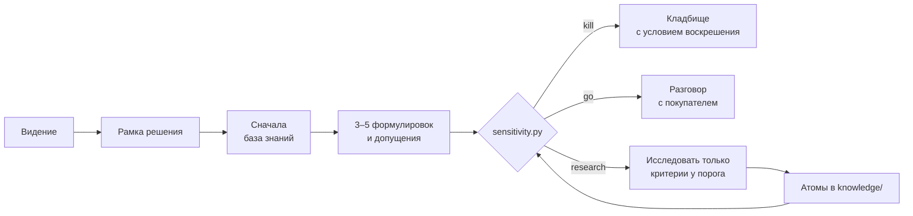

# Исследование как инвестиция

Методология и скилл для Claude Code, которые помогают исследовать идеи стартапов, продуктовые гипотезы и рыночные направления без потерь. Каждое исследование доводится до решения, а всё найденное остаётся в базе знаний для следующих.

> **English summary.** A research methodology and a Claude Code skill for evaluating startup ideas and market hypotheses. It treats every study as an investment that must pay back in three ways: a decision, reusable knowledge and new hypotheses. Value of information picks what to research and when to stop (`scoring/sensitivity.py`). Five depth levels each have a budget and exit criteria. An atomic knowledge base (`knowledge/`) means nothing is searched twice. The docs are in Russian; the scripts are plain Python with no dependencies.

## Зачем

Обычное исследование идеи выглядит так: открыть поиск и читать про рынок, пока не надоест. В итоге уходит много времени, большая часть найденного не влияет на решение, а через месяц то же самое ищется заново для соседней идеи. С LLM-агентом это ещё и дорогие токены.

Здесь исследование считается ставкой, и отдача у неё бывает трёх видов:

1. **Решение:** отсечь, отложить, копать глубже или идти к покупателю.
2. **Знание, которое переиспользуется:** факты о рынках, каналах, покупателях и сделках, разложенные так, что их найдёт следующее исследование.
3. **Новые гипотезы:** развороты, соседние идеи и открытые вопросы.

Исследование, брошенное на середине, не даёт ни одной из трёх. Поэтому у каждого уровня глубины есть критерий завершения.

## Как это работает



Четыре главные идеи, подробности — в [METHODOLOGY.md](METHODOLOGY.md):

- **Ценность информации.** У каждой оценки есть правдоподобный диапазон. `sensitivity.py` считает Score в худшем и лучшем случае. Если даже лучший ниже порога — исследование останавливается, оно не окупится. Если даже худший выше — пора к покупателю, а не за стол. Иначе исследуются только критерии, которые могут перевести Score через порог.
- **Уровни глубины L0–L4.** Скрининг за 15 минут, кабинетная проверка за час-два, досье за полдня, разговоры с покупателями, пилот. У каждого уровня есть бюджет и условие, когда он закончен.
- **Уровни доказательства E0–E6.** От мнения модели до денег на счету. Оценка без источника ограничена потолком: `score.py` делает это автоматически.
- **Атомарная база знаний.** Один факт — одна строка с источником, датой, уровнем доказательства и тегами по понятиям, а не по идеям. Отброшенные гипотезы хранятся вместе с условием, при котором к ним стоит вернуться.

## Быстрый старт

Нужен Python 3.9+, зависимостей нет.

### Вариант 1. Claude Code в этом репозитории

```bash
git clone https://github.com/po-helper-org/research-as-investment.git
cd research-as-investment
claude
```

Дальше просите словами или вызывайте скилл:

```text
/research-idea Заменить соцсети полезным микроконтентом с регулярным обучением под личные цели
```

Claude подхватит [CLAUDE.md](CLAUDE.md), правило и скилл. Он запишет рамку решения, разложит видение на формулировки, прогонит скрипты, сохранит факты в `knowledge/`, а досье — в `dossiers/`.

### Вариант 2. Подключить к своему проекту

```bash
git clone https://github.com/po-helper-org/research-as-investment.git /tmp/rai
mkdir -p .claude/skills .claude/rules dossiers
cp -r /tmp/rai/.claude/skills/research-idea .claude/skills/
cp /tmp/rai/.claude/rules/research-and-knowledge.md .claude/rules/
cp -r /tmp/rai/scoring /tmp/rai/knowledge /tmp/rai/METHODOLOGY.md .
echo "@.claude/rules/research-and-knowledge.md" >> CLAUDE.md
```

Если у вас уже есть своя рубрика, перепишите `scoring/rubric.json` (см. ниже) — скрипты и скилл работают с любой.

### Вариант 3. Любой чат с LLM и веб-поиском

Приложите [METHODOLOGY.md](METHODOLOGY.md) и [scoring/rubric.json](scoring/rubric.json) и попросите:

```text
Исследуй «<видение или идея>» по приложенной методологии и рубрике.
1. Запиши рамку: какое решение обслуживает исследование, уровень L0–L4, бюджет, критерии отсечения.
2. Разложи видение в 3–5 формулировок с разными покупателями, оцени каждую по якорям рубрики.
3. Для лучшей выпиши допущения с уровнем доказательства E0–E6 и диапазоном оценки,
   найди, какие критерии могут перевести Score через порог, и ищи только по ним.
4. Найди хотя бы одно опровержение.
5. Каждый факт выдай строкой JSON в формате атома, отброшенные варианты — с условием воскрешения.
6. Закончи решением и следующим шагом к разговору с покупателем.
```

Факты из ответа сохраните в `knowledge/facts.jsonl`, чтобы следующее исследование начиналось с них.

## Пример

В [examples/deepstash-ru/](examples/deepstash-ru/) разобрано видение «российский аналог Deepstash: заменить соцсети полезным микроконтентом»:

```bash
python scoring/score.py examples/deepstash-ru/idea.jsonl
# {"idea_id": "deepstash-ru-b2c", "score": 2.0, "passes": false}

python scoring/sensitivity.py examples/deepstash-ru/idea.jsonl
# "worst": 1.74, "best": 2.91, "threshold": 3.0, "verdict": "kill"
```

Даже в лучшем правдоподобном случае B2C-подписка не проходит порог: подводят экономика клиента, «кто платит» и канал. Глубокое изучение рынка не окупилось бы. Вместо него исследование выдало два разворота с тем же ядром и 20 фактов в базу. Ещё в примере есть 4 паттерна для любых B2C-идей и запись на кладбище с условием воскрешения. Досье — [dossier.md](examples/deepstash-ru/dossier.md).

## Своя рубрика

`scoring/rubric.json` — рубрика по умолчанию для ранних идей с понятным платящим. Это пример, а не истина. Замените её своей, сохранив формат:

```json
{
  "threshold": 3.0,
  "min_criterion": 2,
  "stop_criteria": {"K1": "Нет понятного платящего"},
  "criteria": {
    "B": {
      "name": "Кто платит",
      "weight": 2,
      "ceiling_without_source": 3,
      "anchors": {"1": "Неясно, кто платит", "3": "...", "5": "..."}
    }
  }
}
```

- **Score** — взвешенное среднее геометрическое оценок 1–5. Единица по любому критерию тянет вниз всю идею: большой рынок не спасает идею без платящего.
- **`weight`** — вес критерия. Вдвое взвешивайте узкие места, например «кто платит», канал и команду.
- **`ceiling_without_source`** — потолок оценки, пока у критерия нет источника в поле `sources` идеи. Так модель не может поставить 5 за «почему сейчас» по памяти.
- **`anchors`** — описания для 1, 3 и 5 баллов. Без якорей оценки модели сползают к середине.
- **`threshold`** и **`min_criterion`** — порог Score и минимальная оценка любого критерия.

Чтобы использовать другую рубрику, не трогая файл: `python scoring/score.py ideas.jsonl --rubric my-rubric.json`.

## Форматы

**Идея** — одна строка JSON:

```json
{"idea_id": "my-idea-001", "idea": "Кто платит, за что, какой механикой",
 "kill": {"K1": false, "K2": false, "K3": false, "K4": false, "K5": false, "K6": false},
 "scores": {"P": 3, "B": 2, "M": 3, "W": 2, "G": 2, "U": 3, "D": 2, "S": 4, "F": 3},
 "sources": {"M": "[Отчёт о рынке](https://...)"},
 "ranges": {"B": [1, 4], "G": [2, 4], "F": [2, 4]}}
```

**Атом базы знаний** — одна строка в `knowledge/facts.jsonl`, формат и правила — в [knowledge/README.md](knowledge/README.md):

```json
{"fact_id": "F-2026-10-18-001", "claim": "Одна проверяемая фраза с цифрой", "as_of": "2025", "checked": "2026-10-18", "source": "[Название](https://...)", "evidence": "E1", "criteria": ["M"], "tags": ["b2c", "ru"], "used_by": ["my-idea-001"]}
```

```bash
python knowledge/kb.py check          # проверить базу
python knowledge/kb.py find b2c G     # найти факты по тегам, критериям или словам
python knowledge/kb.py stale 90       # что пора перепроверить
```

## Структура

| Путь | Что внутри |
| --- | --- |
| [METHODOLOGY.md](METHODOLOGY.md) | Методология: принципы, фреймворки-источники, 8 шагов, уровни L0–L4 и E0–E6 |
| [.claude/skills/research-idea/](.claude/skills/research-idea/) | Скилл Claude Code и шаблон досье |
| [.claude/rules/research-and-knowledge.md](.claude/rules/research-and-knowledge.md) | Правила для любого исследования |
| [CLAUDE.md](CLAUDE.md) | Инструкция для Claude в этом репозитории |
| [scoring/](scoring/) | Рубрика, `score.py`, `sensitivity.py` |
| [knowledge/](knowledge/) | База знаний: факты, паттерны, кладбище, вопросы, журнал окупаемости и `kb.py` |
| `dossiers/` | Ваши досье |
| `ideas.jsonl` | Идеи и развороты из исследований |
| [examples/](examples/) | Разобранные примеры |
| [tests/](tests/) | Тесты скриптов: `python -m unittest discover tests` |

## На чём основано

Методология собрана из проверенных фреймворков. Что взято из каждого и чего не взято — в [METHODOLOGY.md](METHODOLOGY.md):

- Applied Information Economics и ценность информации — Douglas Hubbard, *How to Measure Anything*
- Assumptions Mapping — David J. Bland, *Testing Business Ideas*
- Opportunity Solution Tree — Teresa Torres, *Continuous Discovery Habits*
- Деревья вопросов, MECE и принцип пирамиды — Barbara Minto
- STORM: вопросы с разных перспектив — Stanford OVAL
- Analysis of Competing Hypotheses — Richards Heuer, *Psychology of Intelligence Analysis*
- Премортем — Gary Klein
- Прогноз по референтному классу — Daniel Kahneman, Bent Flyvbjerg
- Confidence Meter — Itamar Gilad, *Evidence-Guided*
- The Mom Test — Rob Fitzpatrick
- Критерии остановки — Annie Duke, *Quit*
- Атомарные исследования — Tomer Sharon, Daniel Pidcock
- Evergreen-заметки — Andy Matuschak

## Ограничения

- Методология не проверена на большой выборке стартапов. Проверка — ваш журнал окупаемости: растёт ли доля переиспользованных фактов, падает ли число поисков на одно решение.
- Бюджеты уровней — стартовые оценки. Поправьте их по своему журналу после 5–10 исследований.
- Рубрика по умолчанию отражает вкус к идеям с понятным платящим. Для B2C, некоммерческих проектов или внутренних продуктов нужна своя.
- Фреймворки описаны в основном по вторичным источникам. Для механик этого достаточно, для точных формулировок читайте первоисточники.
- Пример с данными о российском рынке актуален на 18.10.2026. Факты устаревают, `kb.py stale` подскажет, что перепроверить.

## Лицензия

[MIT](LICENSE). Используйте, меняйте и встраивайте в свои процессы. Будем рады примерам и улучшениям через issues и pull requests.
